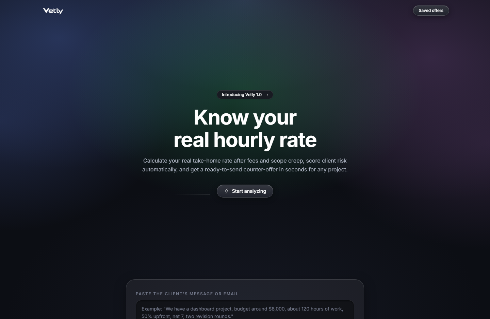
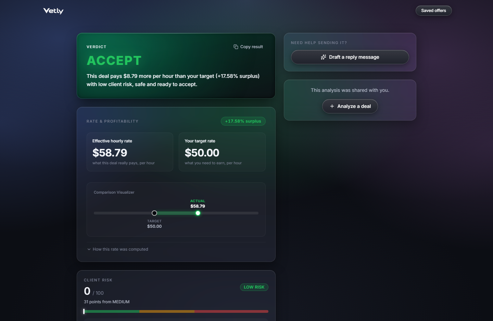

<div align="center">


# Vetly - Freelance Deal Analyzer

**Know what a project offer is really worth before you say yes.**

[](https://vetly-cut.vercel.app)
[](https://testsprite.com)
[](https://vitest.dev)
[](https://nextjs.org)
[](https://www.typescriptlang.org)
[](LICENSE)

</div>

Vetly evaluates freelance project offers (pasted directly from client communication, entered manually, or loaded via 1-click presets) and computes:

- The **real effective hourly rate**, accounting for platform fees, communication overhead, and realistic scope inflation.
- A **client risk score (0-100)** with exact contributing factors.
- A clear **Accept / Negotiate / Reject verdict** with plain-English business rationale.
- Concrete **counter-offer parameters** when negotiation is warranted (target budget, hour cap, and protective contract conditions).
- A **ready-to-send reply draft** for any verdict (clean acceptance with milestone terms, structured counter-offer, or firm scope decline).

Every offer can be saved locally on your device without an account, compared side by side, and shared via public read-only link.

> **Live URL:** [https://vetly-cut.vercel.app](https://vetly-cut.vercel.app) · **Automated PR Testing:** Powered by [TestSprite](https://testsprite.com) (Season 4)

---

## Visual Overview

### 1. Offer Intake and Live Risk Scoring (`/`)


### 2. Analysis Verdict, Rate Visualizer, and Reply Generator (`/result/[id]`)


---

## Architecture and Core Principles

Built for **TestSprite Season 4**. Machine learning only touches the system boundaries: extracting unstructured client messages on intake and formatting conversational replies on output. Every computation in between (effective hourly rate, client risk score, decision matrix resolution, and counter-offer thresholds) is calculated by a **pure deterministic engine with zero runtime framework, database, or LLM dependencies** in its execution path.

This strict boundary isolation allows automated test suites to assert exact numerical values and deterministic outcomes rather than loose approximations.

```
Messy Client Text
       │
       ▼ (LLM Boundary: Smart Paste)
Structured Input Fields
       │
       ▼ (Pure Deterministic Core: src/lib/engine/)
┌────────────────────────────────────────────────────────┐
│ Effective Rate  ·  Risk Score (0-100)  ·  Verdict Card │
│ Counter-Offer Budget  ·  Scope Cap  ·  Contract Terms  │
└────────────────────────────────────────────────────────┘
       │
       ▼ (LLM Boundary: Draft Reply)
Professional Ready-to-Send Email
```

---

## How It Works

1. **`/` (Home)**: Paste the client message (Smart Paste extracts fields via LLM and pre-fills the form for review) or enter parameters manually, or choose a preset scenario. A live risk gauge recalculates as inputs change.
2. **`/result/[id]`**: Displays the final verdict: decision badge, effective rate comparison gauge, risk score breakdown with factor point weights, and concrete counter-offer terms when warranted. Also serves as the public read-only view.
3. **`/compare`**: Displays all saved offers on the device side by side, with 10-item pagination, column sorting, and multi-currency support.

## Technical Stack

- **Next.js 15** (App Router, TypeScript): Unified full-stack deployment on Vercel serverless.
- **Neon Postgres + Drizzle ORM**: Serverless HTTP connection pooling with fast cold starts.
- **Zod**: Shared validation schemas across API routes and client forms. Invalid inputs produce structured HTTP 400 responses with field-specific issue lists.
- **DeepSeek API** (`deepseek-chat`): Dedicated exclusively to Smart Paste field extraction and reply draft generation. Completely isolated from the scoring engine.
- **Vitest**: Unit test suite verifying engine boundary conditions and validation matrices.

The deterministic engine in `src/lib/engine/` consists of pure functions with zero framework, database, or network imports. The same mathematical functions run on the server, in the browser, and in the unit test suite.

---

## Business Constants

The following heuristic constants are explicitly defined for transparent, deterministic calculations:

| Constant | Value | Specification Rationale |
|---|---|---|
| Communication overhead | **+10%** of estimated hours | Meetings, specification review, and deployment require real working time beyond build hours. |
| Revision penalty | **+5%** hours per round beyond 2 | Two revision rounds serve as a standard baseline. Additional rounds require incremental rework. |
| Unlimited revisions penalty | flat **+35%** hours | Uncapped revisions historically cause severe scope creep. A fixed buffer replaces per-round accounting. |
| Risk point weights | deposit 0/10/20/30 · terms 0/10/20/35 · flags 25/20/15/10 | Monotonic risk proxies: later payments and weaker contractual commitments yield higher risk scores. |
| Risk tiers | LOW 0-30 · MEDIUM 31-60 · HIGH 61-100 | Fixed thresholds required for deterministic decisions. The UI shows numeric distance to adjacent tiers. |
| Margin bands | surplus ≥ +20% · fair 0-+20% · deficit < 0% | A +20% surplus over target rate provides necessary buffer for unexpected project overhead. |

Counter-offer logic: Budget adjustments are generated when margin is deficient. Contract conditions are generated when risk tier is MEDIUM or HIGH. Both outputs appear simultaneously when an offer fails both criteria.

---

## Automated Test Coverage

- **`tests/` (Vitest, in-repo)**: Covers the complete PRD boundary matrix: tier transitions at exactly 30/31 and 60/61, margin boundaries at 0% and +20%, platform fee threshold `< 100`, non-integer revisions, the +35% unlimited revisions penalty, the 100-point risk score cap, currency formatting (2 decimal places for USD/EUR/GBP, 0 decimal places for JPY/IDR), all 9 decision matrix cells, counter-offer formulas, contract condition strings, and validation error schemas. **110 tests, all passing.**
- **TestSprite suite (executed against live deployment)**: Validates end-to-end browser and API flows: form intake, Smart Paste extraction fallback, preset switching, live risk updates, owner vs shared-view access gating, 10-item table pagination, column sorting, and LLM reply generation. **53 scenarios, 0 failed, 0 blocked (100% pass rate).**

Across both suites, **163 distinct behaviors are verified automatically on every code change**.

---

### Fail → Fix → Green Engineering Loop

Across 12 test iterations, two findings illustrate the value of automated end-to-end evaluation:

**1. The Ghost Owner Bug**
Vetly allows saving offers locally without requiring user accounts. Early implementations verified offer ownership solely via browser `localStorage`. In local development, the author browser always held ownership credentials. When TestSprite executed an isolated headless session to verify shared links, it simulated a first-time visitor. The visitor was incorrectly served owner controls (duplicate, edit, and compare actions) on a public shared URL (PR #4). The resolution migrated ownership authority to a server-set HTTP cookie (`my_offers`), evaluated on the server before rendering the initial HTML response.

**2. The Test Expectation Conflict**
During PR #5, an end-to-end counter-offer test failed because it assumed budget numbers and contract conditions must be mutually exclusive. Vetly deterministic engine produced both outputs simultaneously for the High-Risk Fixed Scope preset. Reviewing PRD §3.2(C) confirmed that when an offer suffers from both negative margin and elevated risk, the engine is required to output a counter-budget alongside protective contract clauses. The test expectation was corrected to align with the locked specification, preserving the integrity of the core decision engine.

#### Key Engineering Catches Identified by Automated Tests:
- **Input Coercion**: Automated runs submitted values like `"10%"` into numeric fields because of label text. JavaScript `Number("10%")` evaluates to `NaN`. A regex sanitization layer was added to strip percent and currency symbols prior to numeric parsing.
- **Unicode Non-Breaking Spaces**: `Intl.NumberFormat` separates non-USD currency codes (such as IDR) from digits using `\u00A0` (Unicode non-breaking space). Strict string equality assertions failed on visually identical text until formatters were pinned and memoized.
- **Preset State Rehydration**: Rapid switching between preset chips retained stale input values because React reused unkeyed DOM input nodes. Adding unique keys based on `${activePresetId}-${presetRevision}` forced clean component remounts.
- **Headless Clipboard Security**: Headless browser environments block `navigator.clipboard.writeText` by default. An automatic fallback to `document.execCommand('copy')` was implemented to ensure UI copy confirmation states trigger reliably.

#### Complete Iteration Log:

| # | Fail (Observed) | Root Cause | Fix | Result |
|---|---|---|---|---|
| 1 | Vitest: `finiteNumber(...).positive is not a function` at schema import | Validation helper chained `.refine()` (returns `ZodEffects`) before numeric checks that only exist on `ZodNumber` | Restructured the schema so numeric checks chain on `ZodNumber` and refines come last | Suite imports cleanly, green |
| 2 | Vitest: `expected 'IDR 1,234,567' to be 'IDR 1,234,567'` (identical-looking strings) | `Intl.NumberFormat` separates an unknown-symbol currency from the amount with a non-breaking space (`\u00A0`) | Pinned the test to actual deterministic output and memoized one formatter per currency | Green across all runs |
| 3 | Vitest: preset contributions `expected [30,10,15,20,25]` but got `[30,10,25,20,15]` | Test asserted arbitrary flag order from input, but engine emits risk contributions in canonical flag order | Pinned the test to the canonical order | Green |
| 4 | Vitest: deficit-cell counter-offer `expected 3866.67/31h` but got `2933.34/40h` | Test expectations copied from unlimited-revisions preset (+35% penalty), while cell input had 2 free revisions | Corrected expectations to flagless-deficit formulas | Green |
| 5 | `next build`: `Module parse failed` in metadata icon loader | Next.js icon loader embedded project path containing an apostrophe, breaking the generated string literal | Moved favicon to `public/` and declared `metadata.icons` in root layout | Build green |
| 6 | Typecheck: `Property 'targetRate' does not exist on type 'ExtractedFields'` | Extraction schema excludes user target rate (never extractable from client message), but prefill code referenced it | Removed dead prefill branch | Typecheck green |
| 7 | API smoke test: Smart Paste with whitespace-only text returned `200 ok:false` instead of `400` | `min(1)` passed on `"   "` because character count includes spaces | Added `.trim()` before `.min(1)` in extract request schema | Structured HTTP 400 response, green |
| 8 | Transient ICU formatting assertion failure on parallel workers | Parallel test worker environment experienced transient locale caching discrepancy | Memoized `Intl.NumberFormat` instances per currency code as defense in depth | Green across all subsequent runs |
| 9 | TestSprite (PR #2): `Copy a share link from an owned result` failed to confirm in DOM | Headless browser blocked `navigator.clipboard.writeText` by default, aborting execution before state update | Implemented `document.execCommand('copy')` fallback in `OwnerActions.tsx` | Test passed on rerun, check status SUCCESS |
| 10 | TestSprite (PR #3): Form submission failed with `Target hourly rate is required`, preset chips lacked active state, `/share/:id` returned 404 | Form inputs lacked HTML5 `required` attributes, preset buttons lacked `aria-pressed`, and `/share` routes were unmapped | Added `required` and `aria-required` attributes, tracked active preset IDs, and registered `/share/[id]` routes | Pass count increased to 33/38, check status SUCCESS |
| 11 | TestSprite (PR #4): 2 failed tests on preset rehydration and shared view permissions, plus 3 blocked tests on unseeded compare state | Headless browser retained dirty inputs across preset clicks, owner toolbar rendered preview link, client-only localStorage ownership failed in headless tests | Keyed `EntryCard` to force DOM remounts, migrated ownership to HTTP cookies, and provided fixture fallback for compare | TestSprite Run `631a2c24`: 35 passed, 0 failed, 3 blocked (100% on executable tests), merged to `main` |
| 12 | TestSprite (PR #5): 3 failed tests on fixture routing, shared CTA styling, and dual counter-offer matrix assertions | Sample compare fixture URLs lacked fallback on `/result/[id]`, shared links lacked query gating, counter-offer test assumed mutual exclusivity, ACCEPT verdict lacked drafting | Added fixture resolver in `presets.ts`, styled shared CTA with Volta theme, supported AI drafts for ACCEPT verdicts without em-dashes, and aligned test assertions with PRD | TestSprite Run `9e303af4`: 53 passed, 0 failed, 0 blocked (100% pass rate), merged to `main` |

---

## Privacy and Data Handling

Smart Paste submits pasted text to a third-party AI provider (DeepSeek) strictly for extraction. Sensitive personal data should not be submitted. Client names are optional and never required by the deterministic analysis engine. If `DEEPSEEK_API_KEY` is omitted, the application operates in manual entry mode. The core scoring calculations remain entirely independent of external AI services.

---

## Local Development

```bash
npm install
cp .env.example .env.local
npm run db:push
npm run dev
```

### Environment Variables

| Variable | Required | Description |
|---|---|---|
| `DATABASE_URL` | Yes (for persisting offers) | Neon Postgres connection string. Without this, calculation runs in memory and persistence returns HTTP 503. |
| `DEEPSEEK_API_KEY` | Optional | Powers Smart Paste extraction and reply drafting. The application degrades gracefully if unset. |
| `DEEPSEEK_MODEL` | Optional | Custom LLM model override (defaults to `deepseek-chat`). |
| `DEEPSEEK_BASE_URL` | Optional | Custom LLM endpoint override (defaults to `https://api.deepseek.com`). |

### Command Scripts

- `npm run dev`: Starts local development server at `http://localhost:3000`.
- `npm test`: Runs Vitest boundary test suite (110 tests).
- `npm run typecheck`: Runs TypeScript compiler check (`tsc --noEmit`).
- `npm run build`: Generates optimized production build.
- `npm run db:push`: Synchronizes Drizzle schema to Neon Postgres database.

---

## Vercel Deployment

1. Push repository to GitHub.
2. Import project into Vercel using the Next.js preset.
3. Configure `DATABASE_URL` and `DEEPSEEK_API_KEY` in Project Settings → Environment Variables.
4. Execute `npm run db:push` once against the target database to apply schema tables.
5. Deploy.

---

## Interactive 30-Second Demonstration

1. Navigate to `/`. Click preset **"High-Risk Fixed Scope"**. The form populates and the live risk gauge displays **63 / 100 (HIGH RISK)**.
2. Click **Analyze this offer**. The result page outputs **REJECT** with an effective rate of **$11.64/hr** (-61.2% margin against target), a counter-offer budget of **$3,866.67**, a **31-hour** scope cap, and three protective contract conditions.
3. In the reply section, click **Draft a reply message**. The system drafts a structured, professional negotiation email adhering to standardized greeting and sign-off formats.
4. Return to `/`, paste unstructured client project text into Smart Paste, click **Extract**, and observe automated field mapping.
5. Save the analysis and navigate to `/compare` to evaluate multiple saved offers side by side.

---

## API Reference

| Endpoint | Method | Description |
|---|---|---|
| `/api/offers` | POST | Validates input against Zod schema, executes deterministic engine, persists record, returns `201 { id, analysis }`. Invalid inputs return structured HTTP 400. |
| `/api/offers?ids=a,b,c` | GET | Fetches saved offers by ID array (up to 50 IDs) in reverse chronological order for comparison. |
| `/api/offers/[id]` | GET | Fetches single analyzed offer record. Returns HTTP 404 if ID does not exist. |
| `/api/extract` | POST | Submits unstructured message to Smart Paste service. Returns `{ ok, fields, error }` with typed fields. |
| `/api/draft` | POST | Generates standardized reply email based on computed verdict and offer terms. Returns `{ ok, message }`. |

All error responses strictly return structured JSON payloads with field-specific issue lists. The API does not return unstructured 500 errors on invalid user input.

---

## Architectural Constraints by Design

- **Hard Metric Boundaries**: Decision matrix bands and risk tiers employ explicit numeric thresholds. This is mandatory for deterministic testability. The user interface displays exact distance to adjacent thresholds.
- **Counter-Offer Role**: Counter-offer parameters represent mathematically sound baseline values to preserve target hourly yield, not guaranteed commercial outcomes.
- **Native Currency Representation**: Multi-currency comparison displays values in native offer currencies without arbitrary conversion rates, avoiding misleading foreign exchange distortions.
- **Client Ownership Model**: Offer ownership is anchored to an array of identifiers stored in the device HTTP cookie and mirrored in local storage, removing the friction of account creation.

---

## Frequently Asked Questions (FAQ)

### 1. Why does Vetly not require user accounts or login? How does ownership work?
Vetly eliminates account creation friction so freelancers can evaluate offers immediately. Offer ownership is managed through a server-set HTTP cookie named `my_offers`. When an offer is created, the server appends the offer ID to this cookie. The cookie stores up to 50 offer IDs with a 30-day expiration. When a page loads, the server checks whether the requested offer ID exists in the cookie before rendering owner actions.

### 2. How does link sharing work without exposing private owner controls?
Every analysis result is stored under a unique identifier (`/result/[id]` or `/share/[id]`). When a recipient opens the link, the server inspects the recipient browser cookie. If the offer ID is not present in their cookie, the server sets `isOwner` to false. The recipient receives the complete analysis in read-only mode. Owner buttons such as Duplicate, Edit, and Save are removed and replaced with a button to analyze a new offer.

### 3. Does an AI model determine the verdict, risk score, or counter-offer?
No. All calculations are executed by a pure deterministic engine written in TypeScript (`src/lib/engine/`). It contains no machine learning models, database queries, or external network calls. Given identical inputs, it always produces identical numerical outputs. Machine learning is restricted to two boundary tasks: extracting form fields from raw text in Smart Paste, and formatting email text in the reply draft feature.

### 4. Why are business constants like communication overhead (+10%) and revision penalties fixed?
These values represent documented baseline assumptions defined in PRD Section 3.2. Fixed constants prevent subjective variation and enable reproducible results. This allows automated testing tools such as TestSprite and Vitest to verify exact numeric boundaries rather than approximate ranges.

### 5. How does Vetly handle multiple currencies? Does it convert amounts to USD?
Vetly retains the native currency of each offer (USD, EUR, GBP, CAD, AUD, JPY, IDR). It does not convert amounts between currencies because foreign exchange rates fluctuate constantly and can distort effective rates. Formatting strictly respects regional currency conventions, such as zero decimal places for JPY and IDR, and two decimal places for USD and EUR.

### 6. How does the live risk gauge update in real time while typing?
The risk scoring logic in `src/lib/engine/risk.ts` is composed of pure functions without Node.js or browser dependencies. The exact same code executes on the Next.js server and in the client browser. As the user modifies form fields, the client recalculates the score in memory without dispatching network requests.

### 7. What happens if the database or external AI service is unavailable?
The application isolates system boundaries to prevent total failure. If the DeepSeek API is unreachable or the API key is missing, Smart Paste disables gracefully and the user can enter data manually. If the database is unreachable, core calculations still function in memory, and the system displays a clear notification that persistence is temporarily unavailable.

### 8. Does Smart Paste store or retain raw client messages?
No. Text submitted to Smart Paste is forwarded to the AI extraction endpoint to return structured JSON. The server does not log, persist, or reuse raw message text. Data is only written to the database when the user explicitly clicks the analyze button.

---

## Project Structure

```
src/
├── app/                    # Next.js App Router pages and API endpoints
│   ├── page.tsx            # Home view: Hero, presets, and intake form
│   ├── result/[id]/        # Result view and public shared analysis
│   ├── compare/            # Multi-offer comparison table
│   └── api/                # API routes: offers, extract, and draft
├── components/             # User interface components
│   ├── home/               # Intake card, Smart Paste, and live risk gauge
│   ├── result/             # Verdict card, rate visualizer, and draft box
│   ├── compare/            # Sortable comparison table with pagination
│   └── ui/                 # Shared UI primitives, badges, and top loader
└── lib/
    ├── engine/             # Pure deterministic core: rate, risk, decision
    ├── validation/         # Zod schemas shared between form and API
    ├── currency/           # ISO 4217 currency registry and formatters
    ├── db/ · offers/       # Drizzle schema and Neon database services
    └── llm/                # DeepSeek client, Smart Paste, and draft logic
tests/                      # Vitest deterministic boundary suite (110 tests)
public/                     # Static assets and screenshot previews
```

---

## License

This project is licensed under the MIT License. See the [LICENSE](LICENSE) file for details.
